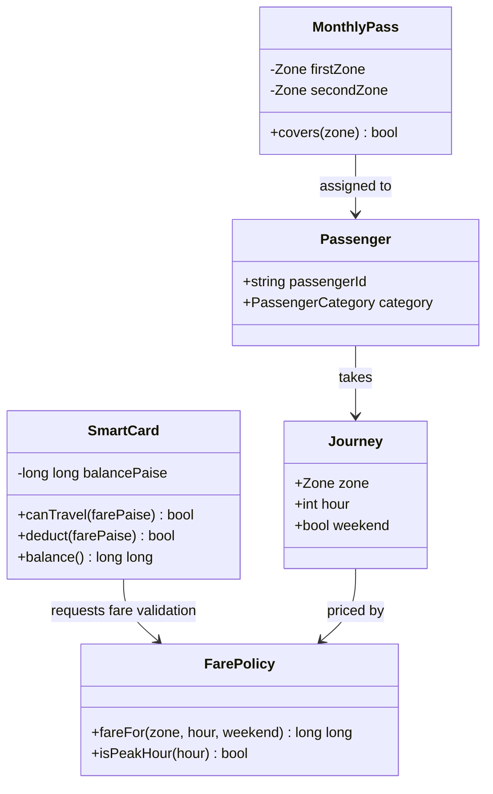

# Task 1 — UML-style class diagram

This is a design sketch rather than a generated UML-tool export. The SmartCard owns and protects balance state; FarePolicy owns fare rules; Journey records the trip facts; Passenger identifies concession eligibility; MonthlyPass is added in Task 12.
